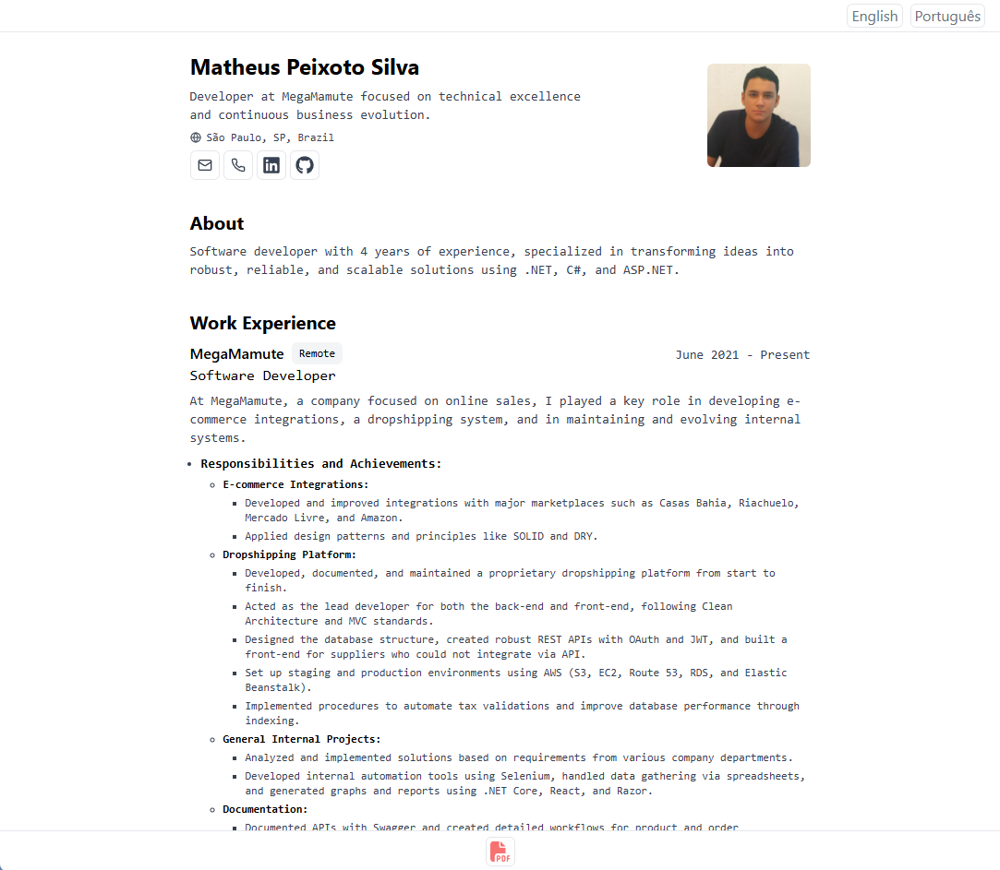

# Resume

This project aims to create a resume optimized for ATS (Applicant Tracking Systems) and TAs (Talent Acquisition Systems). The main idea is to present the content in a clean, simple, and direct way, prioritizing readability and automated analysis. The structure follows a single-column format with clear sections for keywords, technical skills, and other relevant information, all presented in a concise and minimalist way.

## Features

- **ATS and TA focused:**  
  The content, structure, and markup are designed to improve readability by automated recruitment systems. This includes the strategic use of keywords, well-defined sections, and clear formatting that help ATS (Applicant Tracking Systems) and talent acquisition teams identify relevant experience.

- **Single-column layout:**  
  The linear presentation of information, without visual distractions or multiple columns, helps ATS tools process the document without losing context. It also improves human readability and navigation.

- **Bullet points for key information:**  
  The use of bullet lists to highlight responsibilities, achievements, and key skills is highly recommended for ATS/TA. These systems often search for specific terms and highlighted points in bullet format, which increases analysis accuracy and makes the content easier to scan for human recruiters.

- **Minimalism:**  
  By reducing unnecessary visual elements, the document becomes easier for automated tools to parse. A clean and consistent design ensures that the focus remains on the content, helping ATS/TA extract information more efficiently.

- **Responsive design:**  
  Dynamic adjustment to different screen sizes ensures the CV can be viewed clearly on any device without compromising the ATS/TA-optimized structure.

- **Styles optimized for web and PDF:**  
  Tailwind print classes for each media type (browser and PDF) ensure that the printed version maintains readability, proper formatting, and the visual hierarchy designed for ATS/TA, just like the online version. This results in a resume that both machines and human recruiters can easily analyze.

## How to run the project

This project is built with Next.js, requires Node.js 22 or newer, and uses pnpm for dependency management.

### Using PNPM

1. **Install PNPM or another package manager of your choice (the instructions below use pnpm as an example):**  
   If you do not have PNPM installed, see the [official documentation](https://pnpm.io/installation).

2. **Install the dependencies:**  
   ```bash
   pnpm install
   ```

3. **Start the website development server:**
   ```bash
   pnpm dev
   ```

Then open http://localhost:3000 in your browser.

## Develop and generate PDFs

The project generates deterministic A4 PDFs with `0.225in` margins, selectable text, and validated page counts. The available languages and page counts are discovered from `src/data`; they are not hard-coded in the PDF script.

1. Install Chromium once:
   ```bash
   pnpm pdf:install
   ```

2. While editing PDF content, run the live PDF development command:
   ```bash
   pnpm pdf:dev
   ```

   Open http://localhost:4173. The command initially creates every downloadable PDF in `public/pdfs`, then watches the resume data and print-related components. Editing a numbered file such as `ResumeEN1.ts` regenerates that PDF automatically, so there is no need to run `pdf:generate` after every edit. In watch mode a page-count mismatch is reported as a warning and the PDF is still written so you can inspect it.

3. Generate and strictly validate release candidates:
   ```bash
   pnpm pdf:generate
   ```

   The local files are written to `output/pdf`. Generation fails if a PDF has the wrong number of pages, exceeds the file-size limit, or is missing required extractable text.

4. Generate the validated PDFs used by website download buttons:
   ```bash
   pnpm pdf:publish
   ```

   This writes to `public/pdfs`. GitHub Actions runs the same command before building GitHub Pages.

## How to create your own resume from this project

1. **Edit website content**
   The language folders under `src/data` contain a non-numbered file for the normal website, such as `src/data/ResumeEN/ResumeEN.ts`.

2. **Edit PDF-specific content**
   Each numbered TypeScript file contains the complete content for its intended PDF length:

   - `src/data/ResumeEN/ResumeEN1.ts` is the English one-page resume.
   - `src/data/ResumeEN/ResumeEN2.ts` is the English two-page resume.
   - `src/data/ResumePTBR/ResumePTBR1.ts` and `ResumePTBR2.ts` are the equivalent Portuguese variants.

   These are independent authored resumes rather than filters that hide sections from one shared profile.

3. **Add another page-count variant**
   Copy an existing numbered file in the appropriate language folder and use the page count in its name. For example, `ResumeEN3.ts` automatically creates the `/en/pdf/3-page/` route, download button, output filename, and three-page validation target. Run `pnpm resume:discover` if you want to refresh the generated registry immediately; the normal dev, build, and PDF commands do this automatically.

4. **Add another language**
   Create a `src/data/ResumeXX` folder following an existing folder. Its `resume.config.json` declares the locale, filename prefix, and normal website file. Add one or more numbered files using that prefix. The discovery script then creates all PDF routes and metadata automatically. A normal website route for the locale still needs a corresponding page under `src/app`.

The generated registry, metadata, and manifest in `src/data` should not be edited manually. Page size and print margins are defined in `src/app/globals.css`.

## Credits and Inspiration

This project was created from scratch with a focus on ATS/TA optimization and a minimalist visual style. The visual inspiration came from the beautiful project by [Bartosz Jarocki](https://github.com/BartoszJarocki/cv/). All the code is original and only the visual concept was used as a reference to maintain a simplified aesthetic standard.
